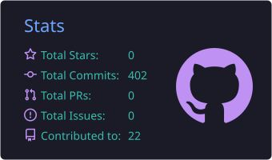
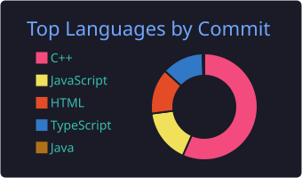

<!-- ===== BANNER ===== --> 

  
 
  
 

## 🧑‍💻 About Me

I'm a Computer Science & Engineering student at the University of Barishal. I love problem-solving in C/C++, building clean and responsive web apps with Next.js, and helping other students grow in tech. I'm always learning, and I enjoy turning ideas into real projects.

## 🚀 What I'm Doing Right Now

- 🔭 Building **StudioSpace**, a peer-to-peer creative studio booking platform (Next.js + Express + MongoDB)
- 🛒 Working on **BazarDor**, a grocery price tracker built with Next.js
- 🌱 Exploring **Next.js** and full-stack development in depth
- 🌐 Planning my personal portfolio website
- 🧠 Practicing Data Structures & Algorithms on Codeforces, CodeChef and LeetCode

## 🌐 Socials:
        

## 💻 Tech Stack:

    
    
    
    
    
    
    

## 🧠 Competitive Programming 

<!--  -->

  

## 🍛 CodeChef

  

   Max Rating:: 1400+ | 2★

## 🚀 Competition Participation

I actively participate in national and intra- and inter-university programming contests, focusing on data structures, algorithms, problem-solving, and teamwork.

---

## 🧠 Contest Highlights

| Competition | Organizer | Team | Achievement | Date |
|-------------|-----------|------|-------------|------|
| BU IUPC'26 | Programming Club BUCSE | - | 🥉 13th | Feb 2026 |
| ICPC Preli | National | BU_Titans | 🥉 | Nov 2025 |

## ✍️ Read My Blogs on [ Medium, Facebook ]

---

| Blog Name                                                   | Platform  | Link |
|------------------------------------------------------------|----------|------|
| কোডের অক্ষরে লেখা এক স্বপ্নের গল্প               | Facebook   | 👉 [Read](https://www.facebook.com/share/p/1AYmEs6ZXN/) |
| আমি কোড লিখি, কিন্তু প্রবলেম সল্ভ করতে পারি না…      | Medium   | 👉 [Read](https://medium.com/@taminulislam27/%E0%A6%86%E0%A6%AE%E0%A6%BF-%E0%A6%95%E0%A7%8B%E0%A6%A1-%E0%A6%B2%E0%A6%BF%E0%A6%96%E0%A6%BF-%E0%A6%95%E0%A6%BF%E0%A6%A8%E0%A7%8D%E0%A6%A4%E0%A7%81-%E0%A6%AA%E0%A7%8D%E0%A6%B0%E0%A6%AC%E0%A6%B2%E0%A7%87%E0%A6%AE-%E0%A6%B8%E0%A6%B2%E0%A7%8D%E0%A6%AD-%E0%A6%95%E0%A6%B0%E0%A6%A4%E0%A7%87-%E0%A6%AA%E0%A6%BE%E0%A6%B0%E0%A6%BF-%E0%A6%A8%E0%A6%BE-a1d7e924cd61) |
| 2045 CLASSROOM — ২০৪৫ সালের একটি স্কুল | Medium | 👉 [Read](https://medium.com/@taminulislam27/2045-classroom-%E0%A7%A8%E0%A7%A6%E0%A7%AA%E0%A7%AB-%E0%A6%B8%E0%A6%BE%E0%A6%B2%E0%A7%87%E0%A6%B0-%E0%A6%8F%E0%A6%95%E0%A6%9F%E0%A6%BF-%E0%A6%B8%E0%A7%8D%E0%A6%95%E0%A7%81%E0%A6%B2-0dc90147d339) |

## 🌟 Extra-Curricular Activities & Leadership

Actively involved in campus leadership, community building, and student advocacy through multiple Campus Ambassador and Associate roles.

---

| Role               | Organization                          | Duration              | Responsibilities & Impact                                                                 | Skills                                      |
|--------------------|----------------------------------------|-----------------------|-------------------------------------------------------------------------------------------|---------------------------------------------|
| Campus Ambassador  | Phitron                               | Dec 2025 – Present    | Promoted programming culture, organized workshops, and guided students in coding.         | Leadership · Teamwork · Management · Networking |
| Campus Ambassador  | Shohoj Coding                               | Jun 2025 – Present    | Coordinated student activities and communication.                        | Team Leadership · Corporate Communication · Teamwork |
| Joint R&D Secretary  | Barishal University IT Society   | Nov 2025 – Present    | Coordinated student activities and communication.    | Leadership · Teamwork |
| Associate IT Executive  | Barishal University Science Club | Jan 2026 – Present    | Coordinated student activities and communication.    | Leadership · Teamwork |

    

## 🏆 Awards & Achievements

Recognition earned through competitive programming, leadership, and academic performance.

| Achievement | Event / Program | Organizer | Position | Year |
|-------------|------------------|-----------|----------|------|
| Best Performer | Phitronista’25 | Phitron | 🏆 Top 1% | 2025 |
| Excellent Leader of June'25 | Campus Ambassador'25 | Shohoj Coding | 🏅 | June 2025 |
| 2★ Coder | Competitive Programming | CodeChef | 🏅 | 2025 |
| Batch Winner | Academic Problem-Solving Hackathon 1.0 | OneByZero Edu | 🏆 Top 1% | April 2026 |
| Solved 1K+ Problems | Self-driven | CP Platforms (CF, CC, LC) | 🎯 Milestone | Ongoing |

## 📊 GitHub Stats:

  
  

  

   

    

     

    

